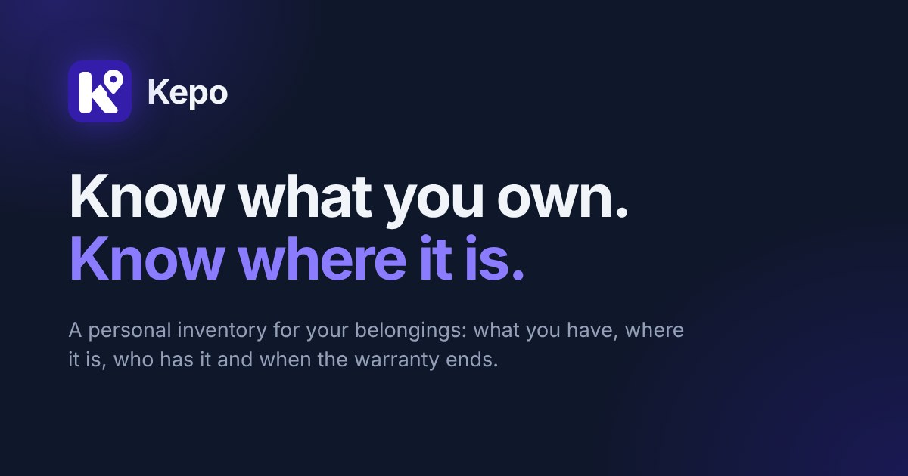

<p align="center">
  
</p>

<h1 align="center">
   Kepo
</h1>

<p align="center"><b>Know what you own. Know where it is.</b></p>

<p align="center">
  <a href="https://app.kepo.is-cool.dev"><b>Web application</b></a> ·
  <a href="https://kepo.is-cool.dev"><b>Landing page</b></a>
</p>

---

Kepo is a personal inventory for your belongings: record what you own, keep it organised by place, see who has borrowed what, and never lose track of a warranty — with the same account on the web and in an Android app, in English or Czech.

<br>

## What is Kepo?

Receipts in a drawer, a warranty you only remember when something breaks, a drill you lent to a neighbour months ago — most of what we own is tracked in our heads. Kepo gives every belonging one record: what it is, where it is, whether someone has it, and when its warranty ends.

It is built for individuals and households who want a simple, private catalogue of their things rather than a spreadsheet. Items live in **nested places** (Home → Garage → Shelf 2), can carry photos and documents such as receipts and manuals, and can be lent out with an expected return date. A dashboard and a reminders page surface what needs attention: overdue loans and warranties that are about to end.

<br>

## Key features

<table>
<tr>
<td width="50%" valign="top">

**Items & places**
- Items with category, status (with me, stored, borrowed, lost, sold, disposed), quantity, brand, model, serial number, value, purchase date, warranty end, notes, and tags
- Nested places with rename, move, and safe deletion (items must be moved first)
- A main photo plus up to 5 extra photos per item; uploaded images are re-encoded and their metadata removed
- Removed items are archived and can be restored

**Photos & documents**
- Up to 20 PDF or image documents per item (receipts, warranty cards, manuals), up to 5 MB each
- The file type is checked from the file's own bytes, and documents are always served as downloads

</td>
<td width="50%" valign="top">

**Borrowing & warranties**
- Lend an item to a named person with an optional return date; edit or return the loan
- A Borrowed list with overdue loans
- A Warranties page grouped into active, expiring soon, and expired
- Optional daily reminder email and a private, read-only calendar feed (`.ics`)

**Find & organise**
- Search, filters (status, category, place, tags, value, warranty, purchase date, photos, documents), and sorting
- Saved filters and bulk actions (move, tag, remove)
- QR labels for items and places, and a scan page
- Insights: counts, value per currency, items per place and category

</td>
</tr>
<tr>
<td width="50%" valign="top">

**Account & security**
- Registration with an emailed verification code, sign-in, and password reset by emailed link
- Change name, email, password, and profile picture; a password change ends all other sessions
- Account deletion with password confirmation
- Data export (JSON and CSV) and item import (CSV or JSON, with a preview)

</td>
<td width="50%" valign="top">

**Language, currency & platforms**
- English and Czech, including server messages and emails
- Currencies CZK, EUR, USD, and GBP; every amount keeps the currency it was entered in and is never converted
- Light, dark, and system theme
- Households: a small group can see (never edit) the items each member chooses to share
- An Android app built with Capacitor

</td>
</tr>
</table>

<br>

## How it works

1. **Set up your places** — create where things live, nested as deeply as you need.
2. **Add your belongings** — record an item with its details, a photo, and its receipt or manual.
3. **Lend and track** — mark an item as lent with a return date; it appears in Borrowed and on the dashboard if it becomes overdue.
4. **Stay ahead** — the dashboard, Warranties page, and reminders show what ends soon or is overdue.

<br>

## Technology / Tech stack

| Layer | Technologies |
|---|---|
| **Frontend** | React 18 + TypeScript, Vite, React Router 6, Tailwind CSS 3 |
| **Backend** | Node.js + Express 4 + TypeScript, JWT in an httpOnly cookie, `bcryptjs` password hashing, `multer` and `sharp` for uploads |
| **Database** | PostgreSQL (via `pg`), plain SQL migrations |
| **Email** | [Resend](https://resend.com) REST API (plain `fetch`) for verification codes, password reset, welcome, password-changed notices, and optional reminder digests |
| **Android** | Capacitor 8 shell (`com.kepo.app`) around the web build |
| **Landing page** | Static HTML and CSS, no dependencies, its own small build script |
| **Tests / CI** | `node:test` through `tsx`, PostgreSQL-backed tests on a throwaway local cluster, GitHub Actions |

<br>

## Architecture

Kepo consists of three independent parts in one repository:

- **`server/`** — an Express + TypeScript REST API under `/api/*`. It talks to PostgreSQL through `pg`; schema changes are SQL files applied by a small migration runner. Every data query is scoped to the signed-in user.
- **`client/`** — a React single-page application that calls the API with cookies (`credentials: 'include'`). The API base URL comes from `VITE_API_URL` at build time. The same build is wrapped by Capacitor in `client/android`, so the Android app uses the same client code and the same API.
- **`landing-page/`** — a static page with no backend. It shares no code with the app and only links to the app's sign-in and registration pages.

The API accepts requests only from the origin set in `CLIENT_ORIGIN` (CORS plus an Origin check on state-changing requests) and builds the links in emails from it. The root `package.json` is the npm workspace root for `client` and `server` (one shared `package-lock.json` and the root scripts used by CI and Render); the landing page has its own manifest and is built separately. The two `types.ts` files (`server/src/types.ts`, `client/src/types.ts`) are kept in step by hand.

<br>

## Project structure

```
kepo/
├── client/                    # React + Vite web app and the Capacitor Android project
│   ├── src/
│   │   ├── pages/             # Dashboard, MyStuff, ItemDetail, Locations, Borrowed, Warranties, Settings, ...
│   │   ├── components/        # Layout, ItemForm, ItemFiles, filters, ui/ primitives
│   │   ├── context/           # Auth, theme, language, toast, data
│   │   ├── i18n/              # en/ and cs/ message catalogs
│   │   └── lib/               # API client, formatting, QR labels, downloads
│   ├── android/               # Capacitor Android project (Gradle)
│   └── capacitor.config.ts
├── server/                    # Express + TypeScript REST API
│   ├── src/
│   │   ├── routes/            # auth, account, items, itemFiles, locations, borrowing, warranties, ...
│   │   ├── db/                # pool, migration runner, migrations/ (SQL)
│   │   ├── auth/              # verification codes and reset tokens
│   │   ├── email/             # Resend transport and templates (en/cs)
│   │   ├── items/ account/ household/ reminders/ calendar/ insights/
│   │   └── middleware/ utils/ i18n/
│   └── scripts/               # PostgreSQL-backed test runner
├── landing-page/              # Independent static landing page
├── docs/                      # Deployment, email, Android, export, backup notes
└── .github/workflows/         # CI
```

<br>

## Running locally

### Prerequisites

Node.js 20 or newer with npm, and a PostgreSQL database. An email provider (Resend) is optional for local work; Android Studio is only needed for the Android project.

### Development

```
# 1. Install everything (client and server workspaces)
npm ci

# 2. Configure the API
cp server/.env.example server/.env     # set DATABASE_URL and JWT_SECRET at least
# For local work without an email provider, add EMAIL_VERIFICATION_REQUIRED=false to server/.env

# 3. Create the schema
npm run migrate

# 4. Start the API (http://localhost:4000) and, in a second terminal, the client (http://localhost:5173)
npm run dev:server
npm run dev:client
```

Without `VITE_API_URL`, the development client calls `http://localhost:4000/api`.

### Production build

```
npm run build        # server (server/dist) and client (client/dist)
npm run migrate      # applies pending SQL migrations to DATABASE_URL
npm start            # starts the built API
```

`client/dist` is a static site: serve it with a rewrite of every path to `index.html`, because the app is a single-page application.

### Checks and tests

```
npm run typecheck    # tsc --noEmit for server and client
npm test             # unit tests for server and client
npm run test:pg      # database tests on a throwaway local PostgreSQL cluster (needs the PostgreSQL server binaries; never touches DATABASE_URL)
```

### Landing page

```
cd landing-page
npm run build        # copies src/ to dist/ and fails on missing local references
npm run preview      # serves dist/ on http://localhost:4173 (override with PORT)
```

### Android

Build the client with an **absolute** `VITE_API_URL` (a relative `/api` would resolve to the WebView's own origin), then from `client/` run `npx cap sync android` and open `client/android` in Android Studio. Signing, App Links, and the open questions around sessions inside the WebView are documented in [`docs/ANDROID.md`](docs/ANDROID.md). Setting `VITE_API_URL` does not by itself prove that Android sign-in works: it is not yet verified on a device. `app-debug.apk` is for testing only; Google Play needs a signed AAB, and every Play upload after the first (`versionCode 1`, `versionName "1.0"`) needs a higher `versionCode`.

<br>

## Environment variables

Copy the example files and keep real values out of Git. **Never commit real values.**

**API — `server/.env`** (see [`server/.env.example`](server/.env.example))

| Variable | Purpose |
|---|---|
| `DATABASE_URL` | **Required.** PostgreSQL connection string. |
| `JWT_SECRET` | **Required.** Secret used to sign session tokens and to key stored verification codes. In production it must not be the placeholder; 32 or more characters are expected. |
| `CLIENT_ORIGIN` | Origin of the web app (CORS, Origin check, base of email links). **Required in production**; defaults to `http://localhost:5173` otherwise. |
| `RESEND_API_KEY`, `EMAIL_FROM` | Email delivery through Resend. Without both, no email is sent. |
| `EMAIL_REPLY_TO`, `EMAIL_LOGO_URL` | Optional reply-to address and logo URL for emails. Note: `EMAIL_REPLY_TO` is visible to everyone who receives a Kepo email. |
| `FEEDBACK_NOTIFY_EMAIL` | **Needed for public release.** Private mailbox notified of every Settings → Feedback message (an email with the number, category, time and the full message text, sent through Resend; no sender details). Without it feedback is stored but nobody is told. See [`docs/FEEDBACK.md`](docs/FEEDBACK.md). |
| `APP_URL`, `LANDING_URL` | Optional. `APP_URL` defaults to `CLIENT_ORIGIN`; `LANDING_URL` defaults to `https://kepo.is-cool.dev` (hosts the logo used in emails). |
| `EMAIL_VERIFICATION_REQUIRED` | Set to `false` for local development without email. Ignored in production. |
| `PORT` | Port of the API (default `4000`). |
| `VERIFICATION_CODE_TTL_MINUTES`, `RESET_TOKEN_TTL_MINUTES`, `EMAIL_RESEND_COOLDOWN_SECONDS` | Optional tuning of code and link lifetime and the resend cooldown. |
| `REMINDERS_ENABLED`, `REMINDERS_HOUR_UTC` | Set `REMINDERS_ENABLED=true` to run the daily reminder job (only for accounts that opted in); the hour defaults to `6` (UTC). |

`NODE_ENV=production` switches on the production behaviour (secure cookies, HSTS, mandatory email verification).

**Client — `client/.env.production` or `client/.env.local`** (see [`client/.env.example`](client/.env.example))

| Variable | Purpose |
|---|---|
| `VITE_API_URL` | Absolute URL of the API including `/api`, baked into the build. Required for production and Android builds. It must never hold a secret. |

The landing page needs no environment variables.

<br>

## Security and data handling

- **Sessions.** The session is an httpOnly cookie holding a signed token (30 days). A password change or reset ends every other session. Passwords are hashed with bcrypt. Login, registration, verification, password reset, import, and export are rate limited.
- **Account isolation.** Every query is scoped to the signed-in user, and the data routes require a verified email address. Documents are never rendered inside the app's origin.
- **Emailed secrets.** Verification codes and reset tokens are stored only as keyed hashes, expire, are single-use, and verification attempts are limited.
- **Uploads.** Images are decoded and re-encoded server-side (location metadata removed); documents are limited to PDF and common image types by content, not by file name.
- **Sharing.** Nothing is shared by default. A household member who turns sharing on exposes only name, category, brand, model, tags, quantity, status, place, and warranty end of active items. A calendar feed address, if created, shows warranty dates, loan return dates and item names (never borrower names) to anyone who has it. Reminder emails likewise name the item and date, not the borrower.
- **Your data.** From Settings you can download your data (not photos, documents or sharing settings; the file and the page say so), remove items (restorable until deleted permanently from the Removed items view) and delete your account, which removes everything in the database. The in-app privacy policy and terms (`/privacy`, `/terms`, Czech and English) name the operator (Milan Fridrich) and use Settings → Feedback as the contact channel; they state that it needs a signed-in account.
- **Feedback.** Settings → Feedback (Bug report, Idea, Privacy, Other) stores messages in the `feedback` table and notifies `FEEDBACK_NOTIFY_EMAIL` (an email with the number, category, time and the full message text, sent through Resend; no name, email address or account details). Sign-in is required. See [`docs/FEEDBACK.md`](docs/FEEDBACK.md).
- **Fonts.** Inter is self-hosted (`client/public/fonts`, `landing-page/src/fonts`, SIL OFL 1.1, license file alongside); no request goes to Google.

<br>

## Deployment

- **Hosting: Render.** Render hosts four separate services (database, API, web app, landing page), described step by step in [`docs/DEPLOYMENT.md`](docs/DEPLOYMENT.md). The test API runs at `https://where-is-it-api.onrender.com`. The intended public addresses are `https://kepo.is-cool.dev` (landing page) and `https://app.kepo.is-cool.dev` (application). This repository contains no Render or DNS configuration, so none of this is verified from here; use [`docs/RELEASE-CHECKLIST.md`](docs/RELEASE-CHECKLIST.md) before going public.
- Email delivery, DNS, and the hosting setup are configured outside the repository. See [`docs/EMAIL.md`](docs/EMAIL.md) and [`docs/BACKUP-RESTORE.md`](docs/BACKUP-RESTORE.md).

<br>

## Project status

Kepo is **pre-release and under active development**. The web application and the API are implemented; automated tests cover the server logic, the database layer, and the client helpers. Still open before a public release: a contact channel for people who cannot sign in, confirmation of the legal bases and governing law in the policy and terms (legal review), verification of the Android app on a physical device (including session handling and the camera scanner), and a rehearsed backup and restore. Planned extensions (for example an iOS app, richer item history, and push notifications) are tracked in [`docs/EXTENSIONS-STATUS.md`](docs/EXTENSIONS-STATUS.md).

<br>

## License

Kepo is licensed under the GNU Affero General Public License v3.0.
See the [LICENSE](LICENSE) file for details.

<br>

## Links

- **Web application** — [app.kepo.is-cool.dev](https://app.kepo.is-cool.dev)
- **Landing page** — [kepo.is-cool.dev](https://kepo.is-cool.dev)
- **Author** — [milanfridrich.is-a.dev](https://milanfridrich.is-a.dev)

---

<p align="center">
  Kepo — Know what you own. Know where it is.<br>
  © 2026 <a href="https://milanfridrich.is-a.dev">Milan Fridrich</a>
</p>
